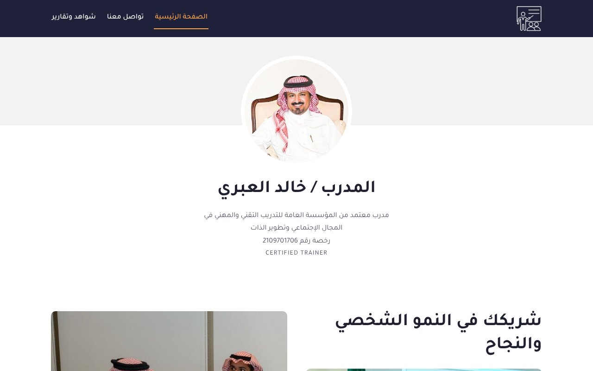
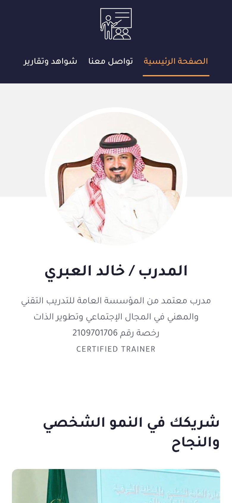

# Khalid Alabri — Coaching Website

**Live site:** https://irbala.github.io/kldmohd/

  
  

Click a screenshot to open the live site.

A small Arabic (right-to-left) website for Khalid Alabri, a certified trainer in social development and self-improvement. Visitors can read about him, see photos from his talks and events, send a message, and go to his Salla store to book sessions.

## Pages

| Page | What's on it |
|---|---|
| `index.html` | Introduction, a link to book through Salla, photos and social media links |
| `Contact.html` | A contact form (embedded Google Form) |
| `album.html` | Photo album of talks, events and certificates |

## How it's built

Hand-written HTML and CSS, with no page builder, frameworks or JavaScript.

- `styles.css` holds the styles for all three pages. Colours are set once as variables at the top.
- The layout is responsive: three photo columns on desktop, two on phones.
- Semantic structure (`header`, `nav`, `main`, `footer`), alt text on every photo, and `lang="ar" dir="rtl"` on every page.

## Design Decisions

- **Navy with a warm orange accent.** Deep navy (`#1f203a`) reads as professional and trustworthy for a certified trainer, and the orange accent adds warmth and draws the eye to the booking link. <!-- guess: Fay, please confirm or edit -->
- **Arabic first.** Every page is `lang="ar" dir="rtl"` and uses Tajawal, a clean modern Arabic typeface that stays readable at small sizes.
- **Hand-written instead of a page builder.** The site was rebuilt from a page-builder export into plain HTML and one stylesheet, which made it far lighter and easy to edit.
- **Use the tools the client already has.** Bookings go to his Salla store and messages go through an embedded Google Form, so there is no backend to maintain and he manages everything in services he knows.
- **Photos as proof.** The album shows talks, events and certificates in a grid (three columns on desktop, two on phones), because for a coach, seeing him in front of an audience builds trust. <!-- guess: Fay, please confirm or edit -->

## Accessibility

Checked on 19 November 2026 with [axe-core](https://github.com/dequelabs/axe-core) 4.10, the engine behind Lighthouse's accessibility score, against WCAG 2.1 A and AA plus axe's best-practice rules. Every page was tested in a desktop browser.

| Page | Issues | Rules passed |
|---|---|---|
| `Contact.html` | ✅ 0 issues | 33 |
| `album.html` | ✅ 0 issues | 31 |
| `index.html` | ✅ 0 issues | 33 |

## Run it locally

Download or clone the repo and open `index.html` in a browser.
